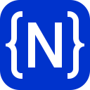

<p align="center">
  
</p>

<h1 align="center">NCode.PropertyBag</h1>

<p align="center">
  Strongly typed property bags for .NET: store and read values by type-safe keys, override a value for a scope, clone a bag, and create bags through dependency injection.
</p>

<p align="center">
  <a href="https://www.nuget.org/packages/NCode.PropertyBag/"></a>
  <a href="https://www.nuget.org/packages/NCode.PropertyBag/"></a>
  <a href="https://github.com/NCodeGroup/PropertyBag/actions/workflows/ci.yml?query=branch%3Amain"></a>
  <a href="https://codecov.io/gh/NCodeGroup/PropertyBag"></a>
  <a href="https://www.nuget.org/packages/NCode.PropertyBag#supportedframeworks-body-tab"></a>
  <a href="LICENSE.txt"></a>
  <a href="https://scorecard.dev/viewer/?uri=github.com/NCodeGroup/PropertyBag"></a>
</p>

A property bag carries context, such as the current user, a culture or a correlation ID, through code that doesn't need to know every value it passes on. Each value is stored and read through a `PropertyBagKey<T>`, which names the value and fixes its type, so a read returns a `T` without a cast.

## Packages

Both packages share the namespace `NCode.PropertyBag`.

| Package | Reference it from |
|---------|-------------------|
| [NCode.PropertyBag](https://www.nuget.org/packages/NCode.PropertyBag/) | Applications: the bag, its factories and AddPropertyBag() |
| [NCode.PropertyBag.Abstractions](https://www.nuget.org/packages/NCode.PropertyBag.Abstractions/) | Libraries that accept or read a bag |

## Installation

```shell
dotnet add package NCode.PropertyBag
```

A library that only accepts or reads bags references the abstractions:

```shell
dotnet add package NCode.PropertyBag.Abstractions
```

The target frameworks are the ones each package's `.csproj` declares; they are listed on [nuget.org's Frameworks tab](https://www.nuget.org/packages/NCode.PropertyBag#supportedframeworks-body-tab) and shown by the badge above. [CHANGELOG.md](CHANGELOG.md) records when a framework is added or dropped and which release line to stay on.

## Quick start

Define each key once, typically as a `static readonly` field:

<!-- snippet: DefineKeys -->
```cs
using NCode.PropertyBag;

public static class UserKeys
{
    public static readonly PropertyBagKey<string> UserName = new("UserName");
    public static readonly PropertyBagKey<int> UserAge = new("UserAge");
}
```
<!-- endSnippet -->

Then create a bag, store values and read them back:

<!-- snippet: BasicUsage -->
```cs
var propertyBag = PropertyBagFactory.Create();

propertyBag.SetValue(UserKeys.UserName, "Alice").SetValue(UserKeys.UserAge, 30);

if (propertyBag.TryGetValue(UserKeys.UserName, out var userName))
{
    Console.WriteLine($"User: {userName}"); // User: Alice
}
```
<!-- endSnippet -->
