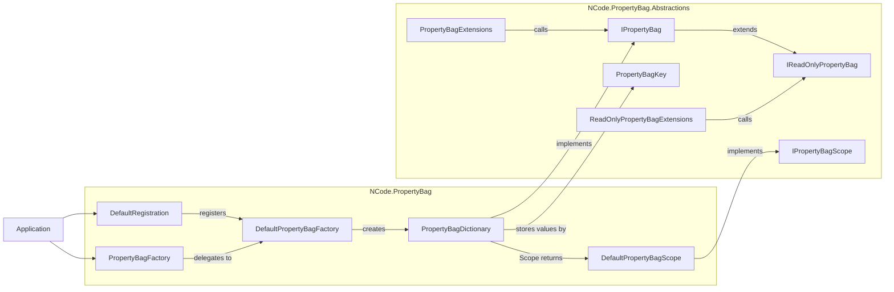

# Architecture

[//]: # "Maintainers: describe the components, as a diagram and a table (Component, Role), and the rules the design
keeps."

How NCode.PropertyBag is built. [assurance-case.md](assurance-case.md) explains why the design meets its security
requirements.

## Components

NCode.PropertyBag is two packages, `NCode.PropertyBag.Abstractions` and `NCode.PropertyBag`, which target the LTS .NET
versions their project files declare (ADR-1002) and share the namespace `NCode.PropertyBag`.

| Component | Role |
| --- | --- |
| `NCode.PropertyBag.Abstractions` | The contracts; no runtime dependency (`JetBrains.Annotations` is compile-time only); code that only passes or reads bags references this package ([ADR-0132](decisions/project-template/0132-implementation-packages-depend-only-on-abstractions.md)) |
| `PropertyBagKey<T>` | Readonly struct naming a value by `Name` and the type `T`; converts implicitly to `PropertyBagKey` |
| `PropertyBagKey` | Readonly struct of `Type` and `Name`, the dictionary key; equal only when both the type and the name (ordinal) match |
| `IReadOnlyPropertyBag`, `IPropertyBag`, `IPropertyBagScope` | `IReadOnlyPropertyBag` has `TryGetValue<T>` and `Clone`. `IPropertyBag` adds `SetValue<T>`, `Remove` and `Scope<T>`, each returning for chaining. `IPropertyBagScope` is the `IDisposable` that `Scope<T>` returns, naming its bag and key |
| `PropertyBagExtensions`, `ReadOnlyPropertyBagExtensions` | `SetValue<T>(value)` and `TryGetValue<T>(out value)`, which name the key after the caller's argument expression (`[CallerArgumentExpression]`); one receiver type per class (ADR-1004) |
| `NCode.PropertyBag` | The implementation; depends on the abstractions and `Microsoft.Extensions.DependencyInjection.Abstractions` |
| `PropertyBagDictionary` | `IPropertyBag`, `IReadOnlyDictionary<PropertyBagKey, object?>` and `ICloneable` over a `Dictionary<PropertyBagKey, object?>` allocated on the first `SetValue`; `TryGetValue<T>` returns a value only when the stored object is `null` or a `T`; `Clone` copies the entries, cloning values that implement `ICloneable`; holds no lock |
| `DefaultPropertyBagScope` | `Dispose` acts once; a scope from `PropertyBagDictionary.Scope` restores the value its key held when the scope was created, or removes the key when it held none, and one constructed directly removes its key |
| `IPropertyBagFactory`, `DefaultPropertyBagFactory` | `Create()` returns a new `PropertyBagDictionary`; `DefaultPropertyBagFactory.Singleton` is a settable static instance |
| `PropertyBagFactory` | Static `Create()` through `DefaultFactory`, settable, which falls back to `DefaultPropertyBagFactory.Singleton` |
| `DefaultRegistration` | `services.AddPropertyBag()` registers `DefaultPropertyBagFactory` as the singleton `IPropertyBagFactory` with `TryAddSingleton`, so an earlier registration wins |
| `NCode.PropertyBag.Tests` | xUnit tests of every type above, on the packages' target framework |
| `NCode.PropertyBag.Site.Tests` | The documentation site's samples, compiled against the public API only, on the packages' target framework ([ADR-1006](decisions/1006-site-samples-are-compiled-tests-in-a-project-of-their-own-included-by-key-when-the-site-is-built.md)) |
| `docs/site/` | The documentation site's pages, settings and API map, built by NCodeGroup/docs ([ADR-1005](decisions/1005-the-documentation-site-is-narrative-guides-built-by-a-shared-toolchain-outside-this-repository.md)) |

Each package's project is in its own folder under `src/`, `src/NCode.PropertyBag.Abstractions/` and
`src/NCode.PropertyBag/`, the tests are in `tests/NCode.PropertyBag.Tests/` and the site samples are in
`tests/NCode.PropertyBag.Site.Tests/`.

The packages do no I/O, start no threads, and share no state except the two settable factory properties.

The packages show people no text and sort nothing: they have no user interface, write no log, console or file, and
define no message of their own. The only exceptions they throw on purpose are `ArgumentNullException` from
`ArgumentNullException.ThrowIfNull`, which are for developers and whose message .NET supplies in its own languages, so
nothing in them needs translating.

## Design Rules

- Decisions the design rests on are recorded in [decisions/](decisions/README.md).
- Warnings are errors ([ADR-0100](decisions/project-template/0100-warnings-are-errors-in-every-project.md)), and
  disallowed APIs are banned at build time
  ([ADR-0102](decisions/project-template/0102-disallowed-apis-are-banned-at-build-time.md)).
- The public API is tracked and evolves compatibly
  ([ADR-0131](decisions/project-template/0131-public-api-is-tracked-and-evolves-compatibly.md)), and each package is
  validated against the last published package
  ([ADR-0147](decisions/project-template/0147-packages-are-validated-against-the-last-published-package.md)).

## Build and Release

`ci.yml` builds, tests and packs every pull request, and fails below 98% line or branch coverage
([ADR-0026](decisions/project-template/0026-tests-gate-coverage-at-the-gold-thresholds-and-a-release-waits-for-them.md)). CodeQL scans the C# code
and the workflows through GitHub's code scanning default setup. Merging a release's pull request, which sets
`version.json` to its version
([ADR-0138](decisions/project-template/0138-package-versions-come-from-version-json-through-nerdbank-gitversioning.md)),
makes `tag-release.yml` run `ci.yml` again on the merged commit and, once it passes, tag that commit, signed with
gitsign, and publish the GitHub release, then start `publish.yml`
([ADR-0016](decisions/project-template/0016-releases-are-tagged-and-published-when-their-pull-request-merges.md)). `publish.yml` tests
and packs the tagged commit and pushes to nuget.org through trusted publishing after a maintainer approves. It then
calls `release-provenance.yml`, which attests the packages and attaches them, a signed provenance file and an SBOM to
the release
([ADR-0139](decisions/project-template/0139-releases-carry-build-provenance.md)), and for a stable version
`raise-baseline.yml`, which opens the pull request that raises the package validation baseline
([ADR-0150](decisions/project-template/0150-a-workflow-raises-the-package-validation-baseline-after-each-release.md),
[ADR-0151](decisions/project-template/0151-release-follow-ups-are-jobs-publish-calls.md)).
`reproducible-build.yml` packs every pull request and push to `main` twice, from checkouts in different folders, and
every Monday rebuilds the newest release's tag, and compares the packages entry by entry with
`build/Compare-Packages.ps1`
([ADR-1010](decisions/1010-package-builds-are-reproducible-and-ci-compares-rebuilds-entry-by-entry.md)).

`docs.yml` builds the documentation site with NCodeGroup/docs, pinned by commit, on every pull request and publishes it
to GitHub Pages at https://propertybag.ncode.io/ from every push to `main`
([ADR-1008](decisions/1008-the-documentation-site-is-published-to-github-pages-from-the-default-branch.md),
[ADR-1009](decisions/1009-the-documentation-site-is-served-at-propertybag-ncode-io.md)).
